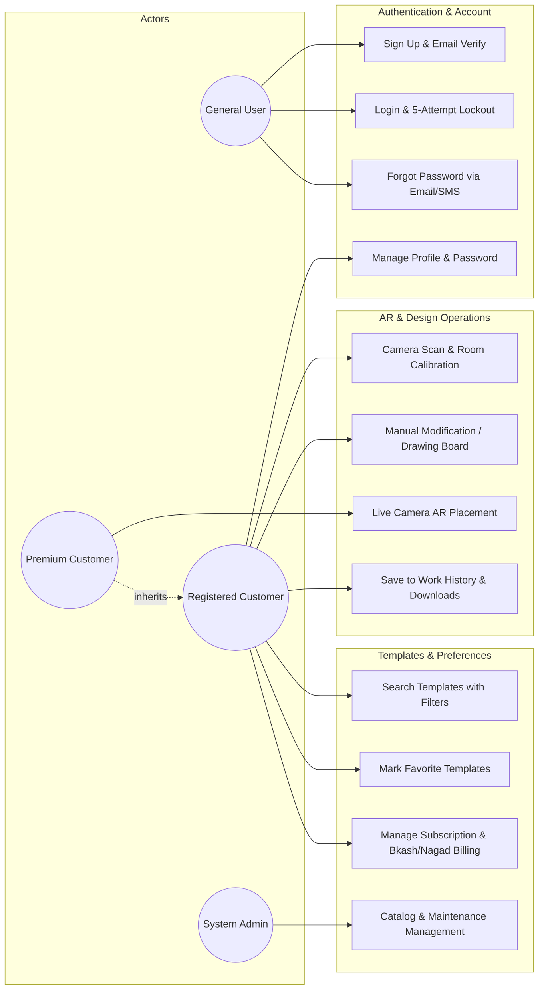
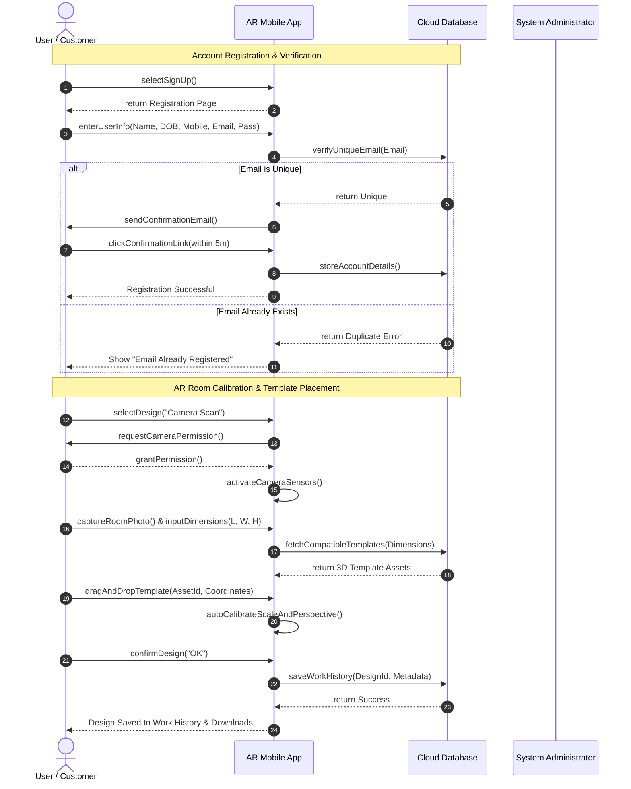
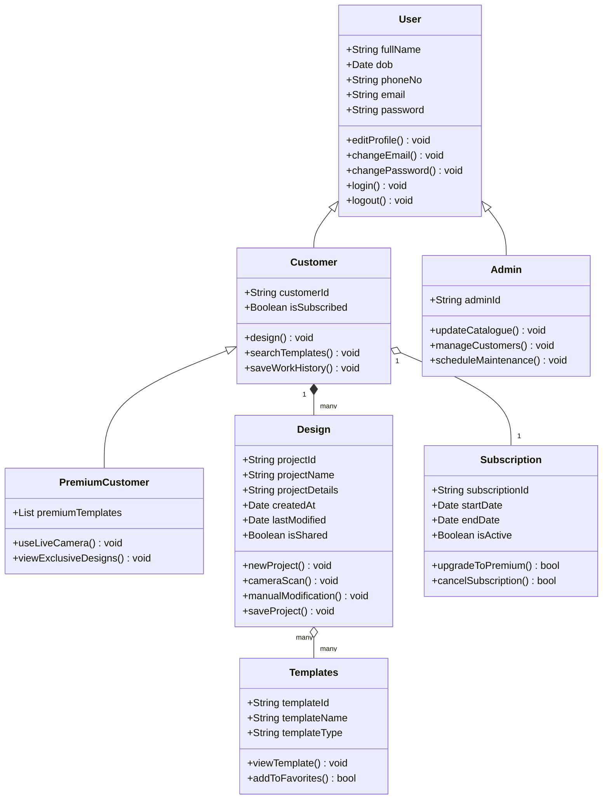

# Augmented Reality Software for Interior Design
### Comprehensive Software Engineering & System Architecture Specification

A comprehensive, industry-standard **Software Engineering System Architecture and Specification Document** for an **Augmented Reality (AR) Interior Design Platform**. This 61-page architectural specification covers the entire software lifecycle from problem definition and agile process model selection to formal Software Requirements Specification (SRS), UML 2.5 system designs, UI/UX wireframes, QA test planning, COCOMO effort estimations, Earned Value Analysis (EVA), and quantitative risk management.

Submitted at **American International University-Bangladesh (AIUB)**, Faculty of Science & Technology.  
**Key Contributor:** [Shakil Jamil Mrida](https://github.com/ShakilJamil) (ID: 22-47275-1, 6-time Dean's Award Recipient).

📄 **Full 61-Page Technical Specification Document:** [Software-Engineering-H-All-Lab-Tasks-Group-5 (2).pdf](Software-Engineering-H-All-Lab-Tasks-Group-5%20(2).pdf)

---

## 📑 Table of Contents
1. [Project Overview & Problem Statement](#-project-overview--problem-statement)
2. [Process Model Selection (Scrum vs XP / DSDM / FDD)](#-process-model-selection)
3. [System Design & UML Modeling](#-system-design--uml-modeling)
   - [Use Case Diagram](#use-case-diagram)
   - [System Architecture Sequence Diagram](#sequence-diagram)
   - [Class Diagram & Domain Entity Relationships](#class-diagram)
4. [Software Requirements Specification (SRS)](#-software-requirements-specification-srs)
5. [Software Project Management & Engineering Metrics](#-project-management--engineering-metrics)
   - [COCOMO Effort & Schedule Estimation](#cocomo-calculations)
   - [Earned Value Analysis (EVA)](#earned-value-analysis-eva)
   - [Work Breakdown Structure (WBS) & Timeline](#wbs--timeline)
6. [Quantitative Risk Management](#-quantitative-risk-management)
7. [Quality Assurance & Test Planning](#-quality-assurance--test-planning)
8. [Individual Contributions](#-shakil-jamil-mridas-contributions)

---

## 🎯 Project Overview & Problem Statement

### The Gap in Traditional Interior Design
Traditional interior design workflows rely heavily on 2D blueprints, physical sample swatches, and static 3D computer renderings. These legacy methods exhibit significant disadvantages:
1. **Visualization Disconnect:** Clients struggle to mentally translate 2D plans or isometric renderings into actual spatial volume and scale.
2. **Costly Re-modifications:** Sizing discrepancies, color clashes, and layout misunderstandings frequently occur after physical procurement and installation.
3. **Prolonged Iteration Cycles:** Designers expend days regenerating 3D models after each round of client feedback.

### The Augmented Reality (AR) Solution
This project specifies a cross-platform mobile and tablet **Augmented Reality Software for Interior Design** that empowers homeowners, architects, and interior designers to:
* Project photorealistic 2D and 3D furniture, fittings, wall textures, and floor tile templates directly into physical rooms using mobile camera sensors.
* Automatically calibrate template dimensions and perspective against inputted room metrics.
* Offer a **Live Camera AR Mode** for premium users to navigate and dynamically position items with live occlusion and lighting adaptation.
* Provide a **Manual Modification & Drawing Board** for architects to sketch custom textures and upload proprietary CAD/3D assets.

---

## 🔄 Process Model Selection

The project analyzed multiple development methodologies before selecting **Agile Scrum**:

| Model | Evaluation & Fit Analysis | Decision |
| :--- | :--- | :--- |
| **Agile Scrum** | Highly iterative sprints allow ongoing feedback loops with architects; accommodates rapid evolution in mobile AR frameworks; well-defined team roles. | **SELECTED ✅** |
| **Extreme Programming (XP)** | Over-relies on continuous pair-programming which was impractical for distributed multidisciplinary asset modeling. | Rejected ❌ |
| **DSDM** | Rigid upfront budgeting constraints limit design flexibility during technical feasibility spikes. | Rejected ❌ |
| **FDD** | Tailored for large enterprise corporations with feature-driven teams; excessive overhead for a focused AR tool. | Rejected ❌ |

### Scrum Roles & Responsibilities
* **Scrum Master:** Facilitates daily standups, sprint reviews, and removes technical/procedural blockers.
* **Product Owner:** Curates the product backlog, prioritizes user stories based on interior design industry needs, and interfaces with client stakeholders.
* **Scrum Team:** Executes sprint backlogs, conducts AR algorithm prototyping, performs UI/UX wireframing, and implements QA automated test suites.

---

## 📐 System Design & UML Modeling

### Use Case Diagram

### Sequence Diagram
*(Authored by Shakil Jamil Mrida — Section 4.3 of Specification)*

### Class Diagram
*(Detailed Domain Relationships — Section 4.2 of Specification)*

---

## 📋 Software Requirements Specification (SRS)

The specification formalizes both **Functional (FR)** and **Non-Functional Requirements (NFR)** across 12 distinct functional modules:

### Core Functional Highlights
* **FR 3.1 & 3.2 (Authentication & Security):** Password masking, unique email verification, 5-minute activation link expiration, and **5-attempt failed login lockout** with automated email alerts and 1-hour account suspension.
* **FR 3.6 (AR Design Engine):**
  * **Camera Scan Mode:** Real-time camera integration with dimensional calibration based on room measurements ($L \times W \times H$).
  * **Live Camera Feature (Premium):** Real-time spatial tracking without manual photo recalibration.
  * **Manual Drawing Board Mode:** Freehand stylus/smart pen drawing rendering into 2D/3D custom assets.
* **FR 3.9 (In-App Subscriptions):** Integration with mobile financial payment gateways (**bKash**, **Nagad**) with PIN verification, auto-activation, and seamless cancellation routines.

### Non-Functional Metrics (NFR)
* **Availability (AV):** $99.9\%$ uptime for all core modules.
* **Performance (PE):** Maximum 2.0-second response latency for login verification, catalog search queries, and AR template placement under standard load.
* **Integrity & Security (IN):** End-to-end encryption for user credentials, payment tokens, and proprietary client designs.

---

## 📊 Project Management & Engineering Metrics

### COCOMO Calculations
*(Authored by Shakil Jamil Mrida — Section 7 of Specification)*

To estimate the engineering effort, timeline, and staffing requirements, the **Constructive Cost Model (COCOMO)** Basic Organic formula was applied:

$$\text{Effort Factor } a = 2.4, \quad \text{Complexity Power } b = 1.05, \quad \text{Schedule Factor } c = 2.50, \quad \text{Schedule Power } d = 0.38$$

Given an estimated code size of **5,500 Source Lines of Code (5.5 KLOC)**:

$$\text{Effort (Person-Months)} = PM = 2.4 \times (5.5)^{1.05} = 14.374 \approx \mathbf{14 \text{ PM}}$$

$$\text{Development Time (Months)} = DM = 2.50 \times (14)^{0.38} = 6.884 \approx \mathbf{7 \text{ Months (28 Weeks)}}$$

$$\text{Average Staff Size} = SS = \frac{PM}{DM} = \frac{14}{6.884} \approx \mathbf{2 \text{ Full-Time Engineers}}$$

---

### Earned Value Analysis (EVA)
*(Quantitative Project Progress Tracking — Section 8 of Specification)*

With $BAC = PM \times 22 = 14 \times 22 = 308 \text{ person-days}$:
* **Budgeted Cost of Work Scheduled (BCWS):** $75 \text{ person-days}$
* **Budgeted Cost of Work Performed (BCWP):** $62 \text{ person-days}$
* **Actual Cost of Work Performed (ACWP):** $65 \text{ person-days}$

$$\text{Schedule Performance Index (SPI)} = \frac{BCWP}{BCWS} = \frac{62}{75} = \mathbf{0.827} \quad (\text{Schedule Variance } SV = -13 \text{ person-days})$$

$$\text{Cost Performance Index (CPI)} = \frac{BCWP}{ACWP} = \frac{62}{65} = \mathbf{0.954} \quad (\text{Cost Variance } CV = -3 \text{ person-days})$$

---

### WBS & Timeline
* **Work Breakdown Structure (WBS):** Level 1 through Level 3 task decomposition across Project Management, Systems Engineering, Software Build, Hardware Interfacing, Deliverables, System Test, and Deployment.
* **Gantt / Timeline Schedule:** 28-week development roadmap partitioned into 6 Agile Scrum sprints preceded by planning and concluded by post-game hardening.

---

## 🛡️ Quantitative Risk Management

A quantitative 16-factor risk matrix was developed assessing risk probability and impact levels ($1 = \text{Catastrophic}, 2 = \text{Critical}, 3 = \text{Marginal}, 4 = \text{Negligible}$):

| Identified Risk Factor | Category | Probability | Impact Level | Mitigation Strategy |
| :--- | :---: | :---: | :---: | :--- |
| **Customer requirement changes** | PS | $80\%$ | **Critical (2)** | Adopt 2-week Scrum sprints with continuous sprint review signoffs. |
| **Technology does not meet expectations** | TE | $30\%$ | **Catastrophic (1)** | Conduct early proof-of-concept spikes on AR camera calibration engines. |
| **Lack of experience with AR SDKs** | DE | $80\%$ | **Marginal (3)** | Allocate dedicated sprint 0 technical training on ARCore / ARKit. |
| **Staff turnover during project** | ST | $60\%$ | **Critical (2)** | Maintain strict modular documentation and cross-train team members. |
| **Funding reduction** | CU | $40\%$ | **Catastrophic (1)** | Establish clear milestone-based deliverables with incremental funding gates. |

---

## 🧪 Quality Assurance & Test Planning

The specification establishes formal test suites with pre-conditions, concrete test data, execution steps, expected outcomes, and pass/fail criteria across all functional units.

Sample test cases executed by **Shakil Jamil Mrida**:
* **`FR_1` (Authentication Login):** Verified correct password hashing, session creation, and error messaging on failed attempts. (`Status: PASS`)
* **`FR_2` (User Registration):** Verified regex validation on mobile numbers and date of birth, unique email checks, and 5-minute activation link lifecycle. (`Status: PASS`)
* **`FR_3` (Forgot Password Recovery):** Validated dual-channel reset workflows via 5-minute email links and 60-second SMS OTP tokens. (`Status: PASS`)

---

## 👨‍💻 Shakil Jamil Mrida's Contributions

As an author and software engineering contributor to this project, Shakil Jamil Mrida owned and delivered the following modules:
1. **Project Proposal & Feasibility:** Problem formulation, economic feasibility, and AR technology integration proposal.
2. **Scrum Model Selection:** Comparative evaluation of Agile methodologies and Scrum role definitions.
3. **SRS Specification:** Complete functional and non-functional specifications for Authentication, Registration, and Password Recovery.
4. **UML Sequence Modeling:** Authored the end-to-end system sequence diagram (Section 4.3).
5. **UI/UX Wireframing:** Designed interface wireframes for Side Navigation, Settings, and Subscription upgrade portals.
6. **COCOMO Cost Estimation:** Calculated person-month effort ($PM = 14$), development timeline ($DM = 7\text{ months}$), and staffing curves.
7. **QA Test Engineering:** Designed and executed formal test cases for modules `FR_1`, `FR_2`, and `FR_3`.
8. **Risk Analysis:** Formulated the risk probability, impact rating, and mitigation strategies.

---

*This repository is maintained as an academic and professional artifact demonstrating rigorous software engineering methodology, architectural documentation, and project estimation standards.*
